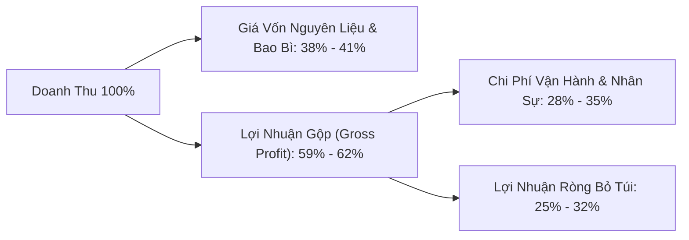

# 📋 BẢN KẾ HOẠCH CHI TIẾT: MÔ HÌNH QUÁN ĂN NHANH (CƠM CHIÊN · MÌ XÀO · BÁNH BAO KẸP · FASTFOOD)

- **Địa điểm triển khai:** Số 2, Đường 7A, Khu phố Phước Thiện, Phường Long Bình, TP. Thủ Đức
- **Mô hình vận hành:** Tổ hợp **Bếp Nóng Chảo Wok (Cơm chiên/Cơm gà xối mỡ/Bò lúc lắc/Mì xào 25K–40K)** kết hợp **Quầy Fastfood Ra Món Nhanh (Bánh Bao Kẹp 18K–26K, Hamburger, Sandwich, Mì Trộn, Mì Cay, Bánh Tráng Trộn)**.
- **Lợi thế cạnh tranh cốt lõi:**
  1. **Đã có sẵn Tủ Quầy** (tiết kiệm ngay ~5.000.000đ vốn đầu tư ban đầu).
  2. **Thực đơn phủ kín 3 khung giờ (Sáng – Trưa – Chiều Tối):** Buổi sáng hút học sinh/người đi làm bằng Bánh bao kẹp (BBK), Burger, Sandwich, Cơm chiên trứng 25K (ra món trong 60–90 giây); Buổi trưa và tối hút khách ăn no bằng Cơm gà xối mỡ, Cơm bò lúc lắc, Mì xào, Hủ tiếu xào, Mì cay đồng giá 40K.

---

## PHẦN 1: DỰ TOÁN VỐN SETUP & VẬT TƯ DỤNG CỤ (CAPEX)

Bảng dự toán dưới đây bám sát **100% danh sách vật tư trong tin nhắn Zalo** (mô hình Bánh bao kẹp, Hamburger, Mì trộn) kết hợp cụm bếp nóng cho nhóm Cơm/Mì xào 40K, chia thành **2 phương án ngân sách**:

### 1.1. Bảng kê chi tiết Thiết bị & Vật tư Dụng cụ

| STT | Hạng mục Vật tư / Thiết bị | Quy cách & Công dụng thực tế | SL | Phương án Tối ưu (VNĐ) | Phương án Mới 100% (VNĐ) | Ghi chú |
| :--- | :--- | :--- | :---: | :---: | :---: | :--- |
| **A** | **CỤM QUẦY BÁNH BAO KẸP · HAMBURGER · MÌ TRỘN (Theo List Zalo)** | | | **6.200.000** | **10.260.000** | |
| 1 | **Tủ quầy bán hàng** | Tủ kính khung inox trưng bày & thao tác kẹp bánh | 1 cái | **0đ** | **0đ** | **Đã có sẵn** |
| 2 | **Tủ lạnh (Đông – Mát)** | Dung tích 250L–350L trữ vỏ bánh bao, gà, tôm, bò, xúc xích, phô mai | 1 cái | 3.200.000 | 5.500.000 | Ưu tiên tủ lướt 90% |
| 3 | **Bếp chiên nhúng điện** | Inox 6L (đơn hoặc đôi) có rổ nhấc ráo dầu, chỉnh nhiệt 170°C | 1 bộ | 750.000 | 1.350.000 | Chiên gà, tôm, xúc xích, mì giòn |
| 4 | **Nồi hấp bánh bao size 42 hoặc 52** | Xửng hấp inox 2–3 tầng giữ nóng vỏ bánh bao mềm xốp | 1 bộ | 850.000 | 1.350.000 | Size 42 (vừa) / Size 52 (lớn) |
| 5 | **Nồi chiên không dầu** | Dung tích 6L–8L, làm nóng lại topping/sườn BBQ trong 60 giây | 1 cái | 950.000 | 1.450.000 | Giúp đồ chiên giòn, ráo dầu |
| 6 | **Khay inox 15×25 cm** | Đựng rau xà lách, dưa leo, cà chua, phô mai, đồ chua tại quầy | 2 cái | 140.000 | 180.000 | 70.000đ – 90.000đ/khay |
| 7 | **Rổ inox 15×25 cm** | Đựng gà rán, tôm rán, xúc xích vừa chiên xong cho ráo dầu | 1 cái | 65.000 | 85.000 | Inox 304 không gỉ |
| 8 | **Bình xịt đựng sốt** | Bộ 3 bình xịt 3 vòi (Tương ớt – Tương cà – Sốt Mayo/BBQ) | 1 bộ | 60.000 | 90.000 | Xịt sốt nhanh & đều |
| 9 | **Gắp kẹp inox** | 1 gắp đồ chiên nóng + 1 gắp bánh bao/rau sạch sẽ | 2 cái | 50.000 | 70.000 | 25.000đ – 35.000đ/cái |
| 10 | **Lưới lọc dầu** | Vợt lưới inox mắt siêu mịn lọc cặn bột chiên cuối ca | 1 cái | 45.000 | 65.000 | Tiết kiệm 35% dầu ăn |
| 11 | **Màng lưới lót xửng hấp bánh** | Lưới silicon chống dính size 40 hoặc 52 (tùy theo nồi hấp) | 3 tấm | 90.000 | 120.000 | Chống nhão/rách đáy bánh bao |
| **B** | **CỤM BẾP NÓNG (CƠM CHIÊN · GÀ XỐI MỠ · BÒ LÚC LẮC · MÌ XÀO · MÌ CAY)** | | | **3.550.000** | **5.200.000** | |
| 12 | **Bếp khè công nghiệp + Bình Gas 12kg + 2 Chảo Wok** | Tạo lửa lớn (Wok Hei) chiên cơm, xào mì, bò lúc lắc, hủ tiếu | 1 bộ | 1.850.000 | 2.600.000 | 1 chảo chiên + 1 chảo xào |
| 13 | **Nồi cơm công nghiệp + Bếp phụ nấu Mì cay** | Nấu cơm hạt tơi + Nấu nước dùng kim chi mì cay & trụng mì trộn | 1 bộ | 1.250.000 | 1.900.000 | |
| 14 | **Dao, thớt, vá, sạn, hũ gia vị, thau inox** | Bộ dụng cụ đứng bếp & hộp nhựa trữ thực phẩm chia sẵn | 1 lô | 450.000 | 700.000 | |
| **C** | **BẢNG HIỆU HỘP ĐÈN · BÀN GHẾ · MÁY IN BILL POS** | | | **2.750.000** | **4.400.000** | |
| 15 | **Bảng hiệu Hộp đèn đứng + Bạt Menu Hiflex** | Thiết kế chữ to nổi bật như mẫu Tuấn Ký / Hưng Ký (35K–40K) | 1 bộ | 1.100.000 | 1.800.000 | Có đèn chiếu sáng ca tối |
| 16 | **Bàn ghế ăn tại chỗ + Máy in bill 58mm Bluetooth** | 4–5 bộ bàn ghế gọn nhẹ + Máy in nhiệt kết nối Web App POS | 1 gói | 1.650.000 | 2.600.000 | Kèm mã QR gọi món tại bàn |
| **D** | **BAO BÌ · NGUYÊN LIỆU MẺ ĐẦU · VỐN LƯU ĐỘNG** | | | **6.100.000** | **8.200.000** | |
| 17 | **Bao bì đóng gói đợt 1** | Túi giấy thấm dầu BBK/Burger, hộp cơm/mì, tô giấy mì cay, đũa muỗng | 1 lô | 1.100.000 | 1.500.000 | Đủ dùng ~10–14 ngày đầu |
| 18 | **Nguyên liệu thực phẩm & Dầu ăn mở hàng** | Gạo, mì, đùi gà, bò, tôm mực, vỏ bánh bao, nhân burger, dầu ăn 20L | 1 lô | 2.500.000 | 3.200.000 | Đủ xoay vòng 3 ngày đầu |
| 19 | **Vốn lưu động dự phòng tại két** | Tiền mặt lẻ thối khách & xoay vòng nhập hàng tuần đầu | Quỹ | 2.500.000 | 3.500.000 | |
| | **TỔNG CỘNG VỐN SETUP BAN ĐẦU** | | | **18.600.000đ** | **28.060.000đ** | |

---

## PHẦN 2: ĐỊNH MỨC GIÁ VỐN (FOOD COST) & CHI PHÍ VẬN HÀNH HÀNG THÁNG (OPEX)

### 2.1. Bảng phân tích Giá vốn (COGS) & Lợi nhuận gộp từng nhóm món

| Nhóm Món | Tên Món Trên Menu | Giá Bán | Giá Vốn (Thực phẩm + Hộp/Túi) | Lãi Gộp / Phần | Tỷ Lệ Food Cost |
| :--- | :--- | :---: | :---: | :---: | :---: |
| **Cơm Nóng** | Cơm Chiên Phủ Trứng | **25.000đ** | 9.000đ | +16.000đ | 36.0% |
| **Cơm Nóng** | Cơm Gà Xối Mỡ / Gà Chiên Mắm Tỏi | **40.000đ** | 16.500đ | +23.500đ | 41.2% |
| **Cơm Nóng** | Cơm Chiên Hải Sản / Cơm Xào Hải Sản | **40.000đ** | 16.000đ | +24.000đ | 40.0% |
| **Cơm Nóng** | Cơm Bò Lúc Lắc / Bò Xào Rau Củ | **40.000đ** | 17.000đ | +23.000đ | 42.5% |
| **Cơm Nóng** | Cơm Sườn Chua Ngọt | **40.000đ** | 16.500đ | +23.500đ | 41.2% |
| **Mì & Hủ Tiếu** | Mì Xào Hải Sản / Mì Xào Bò / Mì Giòn | **40.000đ** | 16.000đ | +24.000đ | 40.0% |
| **Mì & Hủ Tiếu** | Hủ Tiếu Xào Khô / Hủ Tiếu Xào Nước | **40.000đ** | 16.000đ | +24.000đ | 40.0% |
| **Bánh Bao Kẹp** | BBK Xúc Xích | **18.000đ** | 6.500đ | +11.500đ | 36.1% |
| **Bánh Bao Kẹp** | BBK Gà Rán | **20.000đ** | 7.500đ | +12.500đ | 37.5% |
| **Bánh Bao Kẹp** | BBK Tôm Rán | **24.000đ** | 9.000đ | +15.000đ | 37.5% |
| **Bánh Bao Kẹp** | BBK Sườn BBQ | **25.000đ** | 9.500đ | +15.500đ | 38.0% |
| **Bánh Bao Kẹp** | BBK Tôm Phô Mai | **26.000đ** | 10.500đ | +15.500đ | 40.4% |
| **Fastfood / Ăn Vặt** | Hamburger / Sandwich / Mì Trộn / Bánh Tráng | **20K–30K** | 7.000đ – 11.000đ | +13K – 19K | ~36.5% |
| **Fastfood / Ăn Vặt** | Mì Cay 7 Cấp Độ (Bò / Hải Sản) | **40.000đ** | 15.500đ | +24.500đ | 38.8% |

> [!TIP]
> **Bí quyết kiểm soát hao hụt (Food Cost $\le 40\%$):**
> 1. **Chia định lượng theo khay/túi zip từ đầu ca:** Thịt bò lúc lắc, tôm mực, gà rán chia sẵn từng phần chuẩn gram trong tủ lạnh; khi khách gọi chỉ việc lấy 1 túi ra xào/chiên.
> 2. **Sử dụng Lưới lọc dầu cuối mỗi ca:** Lọc sạch vụn bột chiên giúp dầu trong, không bị cháy đen, tiết kiệm ~1.000.000đ tiền dầu ăn mỗi tháng.
> 3. **Dùng Nồi chiên không dầu để làm nóng lại:** Không chiên đi chiên lại topping trong chảo dầu khiến nhân bị khô và hút dầu.

### 2.2. Chi phí vận hành cố định hàng tháng (OPEX)

| Khoản mục | Định mức sử dụng hàng tháng | Chi phí / Tháng | Chi phí / Ngày |
| :--- | :--- | :---: | :---: |
| **1. Mặt bằng (Số 2 Đường 7A, Phước Thiện)** | Mặt bằng khu dân cư (Nếu nhà có sẵn = 0đ) | 3.500.000đ | 117.000đ |
| **2. Điện + Nước + Internet** | Tủ lạnh 24/24, bếp chiên nhúng, nồi chiên ko dầu, đèn bảng hiệu | 1.500.000đ | 50.000đ |
| **3. Gas công nghiệp** | ~3 bình gas 12kg (Bếp khè xào Wok + Nồi hấp bánh bao) | 1.400.000đ | 47.000đ |
| **4. Dầu ăn hao hụt & Gia vị/Sốt nền** | Dầu chiên, tương ớt, sốt mayo, sốt BBQ, nước mắm tỏi, dầu hào | 1.500.000đ | 50.000đ |
| **5. Nhân sự (Phương án Tinh gọn)** | Chủ đứng bếp chính + 2 nhân viên Part-time phụ ca Sáng & Tối | 6.800.000đ | 227.000đ |
| **TỔNG OPEX CỐ ĐỊNH / THÁNG** | | **14.700.000đ** | **491.000đ/ngày** |

---

## PHẦN 3: KẾ HOẠCH NHÂN SỰ, PHÂN CA & DÂY CHUYỀN VẬN HÀNH (HR PLAN)

### 3.1. Cơ cấu 3 Ca làm việc trong ngày

1. **🌅 Ca Sáng (06h00 – 10h30 | 4.5 tiếng):**
   - **Món chủ lực:** Bánh Bao Kẹp (18K–26K), Hamburger, Sandwich, Mì Trộn, Cơm Chiên Phủ Trứng (25K).
   - **Nhân sự:** 01 Nhân viên Quầy Fastfood (kết hợp Chủ quán sơ chế nguyên liệu trưa).
   - **Thao tác dây chuyền 60 giây:**
     - `05h45`: Bật nồi hấp size 42/52 (lót màng lưới chống dính), xếp bánh bao vào hấp nóng; bật bếp chiên nhúng lên 170°C; xếp rau xà lách, dưa leo, phô mai ra **2 khay inox 15×25**.
     - Khi khách gọi món: Gắp nhân (xúc xích, gà rán, tôm rán) từ **rổ inox 15×25** (hoặc bắn nóng 45 giây trong **nồi chiên không dầu**), dùng **gắp kẹp inox** lấy vỏ bánh bao nóng, kẹp rau + nhân + xịt sốt từ **bình xịt 3 tia** -> Bỏ túi giấy giao khách ngay.

2. **☀️ Ca Trưa (10h30 – 14h30 | 4.0 tiếng):**
   - **Món chủ lực:** Cơm Gà Xối Mỡ, Cơm Gà Mắm Tỏi, Cơm Bò Lúc Lắc, Cơm Chiên/Xào Hải Sản, Mì Xào, Hủ Tiếu Xào (40K).
   - **Nhân sự:** 01 Bếp Chính (đứng chảo Wok & bếp chiên xối mỡ) + 01 Phụ bếp/Đóng hộp/Thu ngân POS.
   - **Thao tác tốc độ cao:** Cơm chiên nền đã đảo sẵn mẻ lớn; gà góc tư đã hấp/chiên sơ 80%. Khi có đơn chỉ cần xối mỡ gà 90 giây cho da giòn rụm hoặc lắc chảo bò/hải sản 2 phút là đóng hộp giao ngay.

3. **🌆 Ca Chiều – Tối (16h00 – 22h00 | 6.0 tiếng):**
   - **Món chủ lực:** Toàn bộ Menu (Khung 16h00–18h00 học sinh tan học mua BBK, Burger, Bánh tráng trộn, Mì trộn; Khung 18h00–21h30 cư dân Phước Thiện ăn tối Cơm/Mì xào & Mì cay 7 cấp độ).
   - **Nhân sự:** 01 Bếp Chính + 01 Nhân viên Quầy Fastfood & Thu ngân POS.

### 3.2. Chính sách Lương & Thưởng KPI Nhân viên

| Vị trí | Khung giờ | Lương cơ bản | Phụ cấp & Thưởng KPI | Thu nhập / Tháng |
| :--- | :--- | :---: | :--- | :---: |
| **Bếp Chính (Chảo Wok)** | 10h00–14h30 & 16h00–22h00 | Chủ quán đứng bếp *(hoặc thuê 8.000.000đ)* | Thưởng 500K–1M nếu giữ chuẩn Food Cost $\le 40\%$ | **0đ** *(hoặc 8.5–9tr)* |
| **NV Phụ Ca Sáng (Part-time)** | 06h00 – 11h00 (5h/ngày) | 20.000đ/giờ (~3.000.000đ) | +2.000đ/h chuyên cần + Thưởng 20K/ca khi bán $>45$ phần sáng | **3.300.000đ – 3.500.000đ** |
| **NV Phụ Ca Tối (Part-time)** | 16h00 – 22h00 (6h/ngày) | 20.000đ/giờ (~3.600.000đ) | +2.000đ/h chuyên cần + Thưởng 25K/ca khi doanh thu tối $\ge 2$ triệu | **3.500.000đ – 4.000.000đ** |

---

## PHẦN 4: ĐIỂM HÒA VỐN & DỰ PHÓNG LỢI NHUẬN RÒNG (ROI)

- **Chi phí vận hành cố định 1 ngày:** $\approx 491.000\text{đ/ngày}$ (Phương án Tinh gọn, đã gồm mặt bằng 3.5tr + điện + gas + dầu sốt + 2 nhân viên part-time).
- **Lãi gộp trung bình mỗi phần bán ra:** $\approx 19.000\text{đ/phần}$ (Tỷ lệ lãi gộp trung bình ~60%).
- **👉 ĐIỂM HÒA VỐN (Break-Even Point):**
  $$\text{Sản lượng hòa vốn} = \frac{491.000\text{đ}}{19.000\text{đ/phần}} \approx \mathbf{26\text{ phần/ngày}} \text{ (Doanh thu hòa vốn } \approx \mathbf{820.000\text{đ/ngày}}\text{)}$$
  *(Chỉ cần bán được 10 chiếc Bánh bao kẹp buổi sáng + 8 hộp cơm trưa + 8 phần cơm/mì tối là quán đã đủ trả toàn bộ mặt bằng, điện, nước, gas và lương nhân viên!)*

### Bảng Dự Phóng 3 Kịch Bản Doanh Thu & Lợi Nhuận Thực Tế

| Chỉ số Tài chính | Kịch bản Thận Trọng (Mới mở) | Kịch bản Trung Bình (Ổn định) | Kịch bản Tốt (Đông khách + App) |
| :--- | :---: | :---: | :---: |
| **Số lượng BBK / Burger / Ăn vặt (TB 23K)** | 30 phần/ngày | 45 phần/ngày | 70 phần/ngày |
| **Số lượng Cơm Chiên Trứng (25K)** | 15 phần/ngày | 25 phần/ngày | 35 phần/ngày |
| **Số lượng Cơm Gà / Bò / Mì Xào / Mì Cay (40K)** | 35 phần/ngày | 55 phần/ngày | 85 phần/ngày |
| **Tổng số phần bán / ngày** | **80 phần/ngày** | **125 phần/ngày** | **190 phần/ngày** |
| **Doanh thu / ngày** | **2.465.000đ** | **3.860.000đ** | **5.885.000đ** |
| **Doanh thu / tháng (30 ngày)** | **73.950.000đ** | **115.800.000đ** | **176.550.000đ** |
| Trừ Giá vốn thực phẩm & hộp (COGS ~40%) | -29.385.000đ | -46.065.000đ | -70.245.000đ |
| **Lợi nhuận gộp (Gross Profit)** | **44.565.000đ** | **69.735.000đ** | **106.305.000đ** |
| Trừ Chi phí vận hành + Nhân sự (OPEX) | -14.700.000đ | -14.700.000đ | -18.500.000đ *(tăng ca)* |
| **💰 LỢI NHUẬN RÒNG BỎ TÚI / THÁNG** | **+29.865.000đ** | **+55.035.000đ** | **+87.805.000đ** |
| **⏱️ Thời gian thu hồi vốn Setup (~18.6tr)** | **~0.7 tháng (20 ngày)** | **~0.4 tháng (11 ngày)** | **~0.3 tháng (8 ngày)** |
